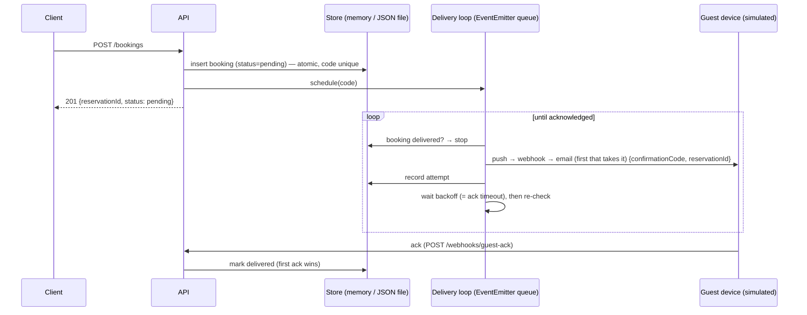

# Pentice API — booking confirmations

`POST /bookings` creates a booking with a unique 5-character confirmation code.
The code is **not** returned in the response. It is delivered out-of-band to the
guest's (simulated) device, and the server keeps resending until the device
acknowledges it. `GET /:code` resolves a code to its booking, **once**: like
an OTP, a code that was already used answers `410 Gone`.

No database and no external services: bookings live in memory or in a JSON
file, behind an async repository.

## Run it

```bash
bun install
bun run dev            # http://localhost:3000  (docs at /openapi)
bun run test           # vitest, no services needed
# or: docker compose up --build
```

The brief's example:

```bash
curl -XPOST localhost:3000/bookings -H 'content-type: application/json' \
  -d '{"reservationId":"R123","guest":"ana@example.com"}'
# 201 {"reservationId":"R123","status":"pending"}      ← no code here

curl localhost:3000/simulator/device                  # the guest's inbox → the code
curl localhost:3000/<code>
# 200 {"reservationId":"R123","guest":"ana@example.com","confirmationCode":"<code>",
#      "status":"delivered","redeemedAt":"…","delivery":{"attempts":1,"lastChannel":"push",...}}
curl localhost:3000/<code>
# 410 {"error":"confirmation code already used"}
```

Simulate an unreliable phone and watch the retries in the logs:

```bash
curl -XPOST localhost:3000/simulator/device -H 'content-type: application/json' \
  -d '{"online":false}'
# or {"unreachableChannels":["push","webhook"]}  → failover to email
# or {"dropMessageRate":0.5,"dropAckRate":0.5}   → lost messages / lost acks
```

## How delivery works



1. **Persist first, deliver after.** A `pending` booking *is* the outbox entry.
   The code and "we still owe the guest a confirmation" are one write, so
   nothing can be persisted without also being scheduled for delivery.
2. **Only an ack counts.** A successful send only means the message left; it
   doesn't prove it arrived. The booking turns `delivered` only when the device
   acks. Until then every attempt is followed by a wait (the ack timeout), and
   then the booking is checked again.
3. **Retry forever, with capped backoff.** Waits are 2s, 4s, 8s… up to 30s,
   with ±20% jitter and no attempt limit. A phone that is offline for an hour
   still gets the confirmation once it's back. `/health` shows
   `pendingDeliveries` so a growing backlog can be seen.
4. **Channels are a failover chain, not a fan-out.** Push, webhook and email
   all extend one `NotificationChannel` base class. Each attempt sends on the
   *first* channel that takes it (order: `DELIVERY_CHANNELS`, default
   `push,webhook,email`). Sending on all three at once would show the guest the
   same code three times.
5. **Survives restarts.** With `STORE_DRIVER=file`, the delivery loop re-queues
   every `pending` booking on boot.

### Single-use codes

`GET /:code` *uses* the code. The first call fills `redeemedAt` and returns the
booking. Every later call with that code gets `410 Gone`. The check and the
write are one atomic repository call (`redeem`), so two concurrent calls can't
both win (tested). Malformed and unknown codes both answer `404`. Redeeming is
independent of delivery: a redeemed code that is still unacked keeps being
retried, and the device dedupes the extra copy.

### "A guest should never receive the same confirmation twice"

Over an unreliable network, exactly-once delivery isn't possible. If an ack is
lost, the server can't tell "never arrived" from "arrived, ack lost", and it has
to resend or risk the guest never getting it. So the design is **at-least-once
delivery + an idempotent receiver**:

- **Server side:** no more sends after the first ack. There is one job per
  booking (the queue dedupes on job id and never runs the same id twice at
  once), so concurrent duplicate sends can't happen. A repeated `POST` for the
  same reservation returns the existing booking and never mints a second code.
- **Device side:** the device dedupes by confirmation code. A redelivered copy
  isn't shown again; it's only re-acked (`GET /simulator/device` shows
  `timesReceived` vs. one inbox entry). The guest sees each confirmation once.

## Decisions & assumptions

| Decision | Why |
| --- | --- |
| Push, webhook, email as a failover chain | One message per attempt, so the guest isn't sent the code on 3 channels. If a channel is down, the next one is tried in the same attempt. For email, the "ack" stands for a confirmation link or the mail client calling back. |
| Device simulated in-process | Lets tests and demos control offline, an unreachable channel, a lost message or a lost ack precisely. A real device would call `POST /webhooks/guest-ack`, which runs the same usecase the simulator calls. |
| Codes: first 5 chars of `crypto.randomUUID()` | Simple and random (a v4 UUID's version bits come later). Hex, so letters + digits, 16⁵ ≈ 1M codes. Collisions are handled by the atomic insert (draw again). Trade-off: a smaller space than full `[a-z0-9]` (60M), so easier to guess. Single use limits the damage, and rate limiting `GET /:code` would be the next step. |
| Uniqueness via atomic `insert` | Check-then-save would let two concurrent requests take one code. `insert` refuses a taken code (we regenerate) or reservation (idempotent replay, or `409` if the guest differs). Tested with 1000 concurrent bookings. |
| Store: JSON file (default) or memory | Spec: no DB, async I/O. Writes go to a temp file, are `rename`d into place (atomic) and are serialised. Fine for one process. A real system would use a real store. |
| Queue: in-process, on Node `EventEmitter` | Same contract a Redis/BullMQ queue would have (job id dedupe, delays, retry with backoff), with no infrastructure. Durability comes from the store, not the queue. |
| `POST /bookings` → `201` new, `200` replay | Lets clients retry safely. |

**Limits (single process by design):** the in-memory maps, the file store and
the queue assume one instance. To scale out: move the store to a real database
(conditional update for `markDelivered`), the queue to a shared broker behind
the same `JobQueue` port, and add a lease so only one node sends a given
booking. Retention/expiry of old bookings and auth on the ack endpoint (e.g. an
HMAC-signed delivery token) are out of scope.

## Layout

Grouped by kind, so you can jump straight to the usecases, controllers,
repositories and so on:

```
src/
  index.ts                 boot: start the delivery loop, listen, graceful shutdown
  app.ts                   Elysia app: error handling, tracing, docs, /health, controllers
  config/                  env.ts (validated env), openapi.ts (docs), otel.ts
  controllers/             bookings-controller.ts  — the API: POST /bookings, GET /:code,
                                                     POST /webhooks/guest-ack
                           simulator-controller.ts — demo only: /simulator/device
  usecases/                create-booking, deliver-confirmation, acknowledge-confirmation,
                           redeem-confirmation, delivery-loop (retries + boot recovery)
  domains/                 booking.ts (type + state transitions), confirmation-code.ts
  repositories/            booking-repository.ts (contract + app instance), in-memory, json-file
  channels/                channel.ts (base class), push, webhook, email
  queues/                  job-queue.ts (contract), event-emitter-job-queue.ts
  simulators/              device-simulator.ts (the guest's phone)
  lib/                     logger, result, backoff, async
test/                      same folders as src/, plus e2e/
```

**Wiring:** there's no container. Each file ends with its ready-to-use
instance, built from the instances it needs:

```ts
// usecases/create-booking.ts
export const createBookingUseCase = new CreateBookingUseCase(
	bookingRepository,
	deliveryLoop,
);
```

Controllers import those instances directly. Configuration comes from env:
`STORE_DRIVER` picks the repository, `DELIVERY_CHANNELS` the channels, and the
`DELIVERY_*` timings the backoff. Unit tests still build the classes with their
own dependencies, e.g. `new CreateBookingUseCase(new InMemoryBookingRepository(), fakeScheduler)`.

## Endpoints

| Method | Path | |
| --- | --- | --- |
| `POST` | `/bookings` | `{reservationId, guest}` → `201` / `200` replay / `409` / `422` |
| `GET` | `/:code` | booking + delivery status, **single use**: `410` once used, `404` if unknown |
| `POST` | `/webhooks/guest-ack` | `{confirmationCode}`, idempotent |
| `GET`/`POST` | `/simulator/device` | inbox / set `online`, `unreachableChannels`, `dropMessageRate`, `dropAckRate`, `ackDelayMs` |
| `GET` | `/health` | store readiness, pending deliveries, queue stats |

## Configuration

Set in `src/config/env.ts` (validated at boot): `API_PORT`, `STORE_DRIVER`
(`file`|`memory`), `STORE_FILE`, `DELIVERY_ACK_TIMEOUT_MS` (2000),
`DELIVERY_MAX_BACKOFF_MS` (30000), `DELIVERY_CHANNELS` (`push,webhook,email`),
`WEB_ORIGINS`, `OTEL_SERVICE_NAME`, `OTEL_EXPORTER_OTLP_ENDPOINT` (empty =
tracing off).
