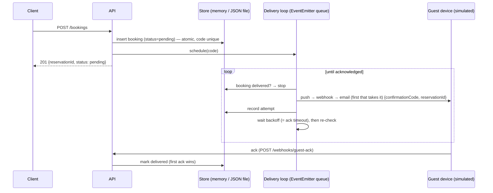
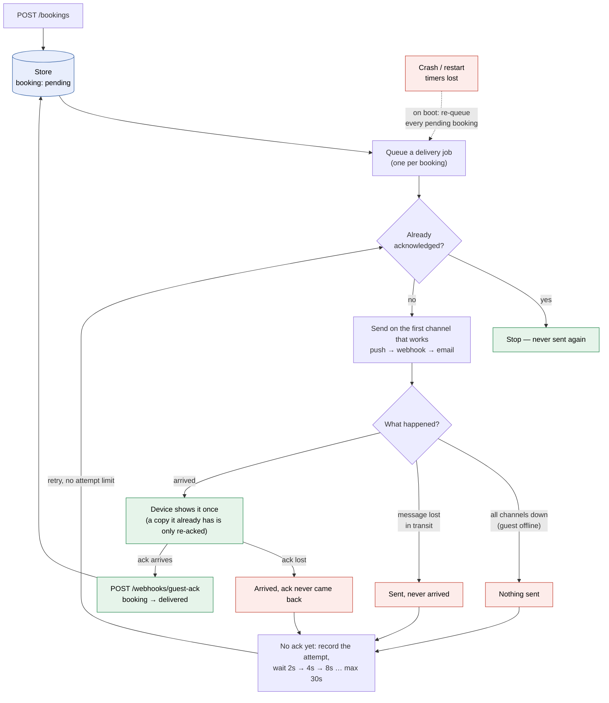
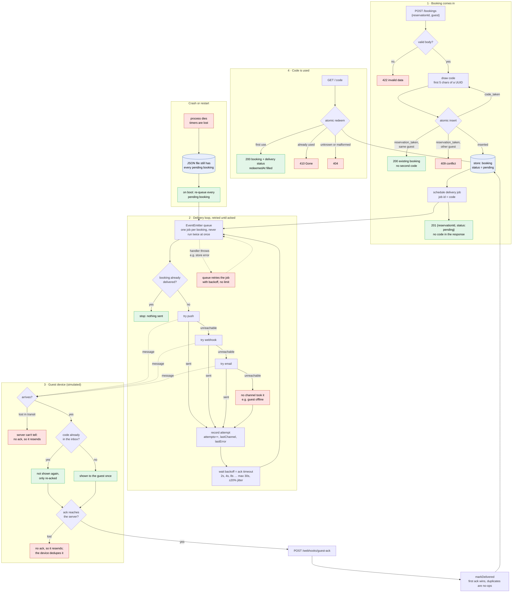
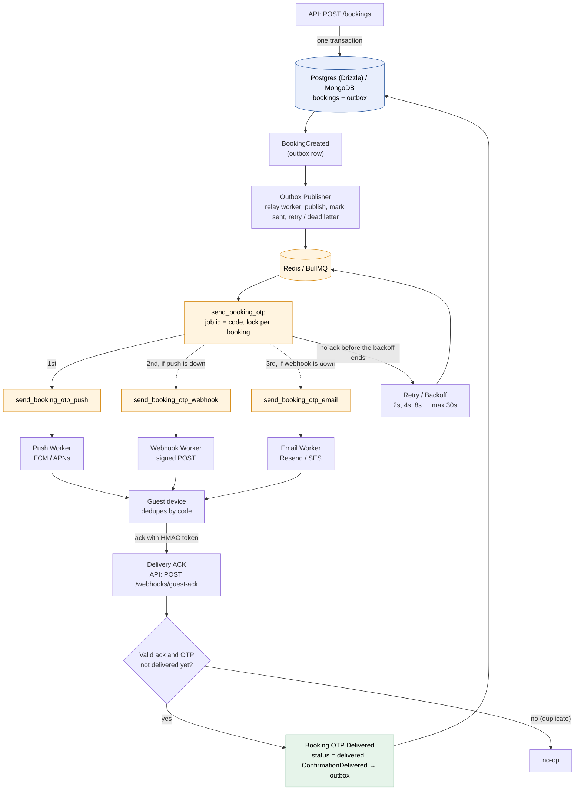

# Pentice API — booking confirmations

`POST /bookings` creates a booking with a unique 5-character confirmation code.
The code is **not** returned in the response. It is delivered out-of-band to the
guest's (simulated) device, and the server keeps resending until the device
acknowledges it. `GET /:code` resolves a code to its booking, **once**: like
an OTP, a code that was already used answers `410 Gone`.

No database and no external services: bookings live in memory or in a JSON
file, behind an async repository.

> **This is a deliberately simplified version.** The brief rules out a
> database, so storage, queueing and locking all run inside one process. Every
> one of them sits behind a contract (`BookingRepository`, `JobQueue`,
> `NotificationChannel`). The production pieces — Postgres via Drizzle (or
> another ORM, or MongoDB), Redis/BullMQ, an outbox for domain events — plug
> in behind those contracts without touching the use cases. See
> [Next steps: production version](#next-steps-production-version).

## Run it

```bash
bun install
bun run dev            # http://localhost:3000  (docs at /openapi)
bun run test           # vitest, no services needed
# or: docker compose up --build
```

**Dokploy:** use `docker-compose.dokploy.yml`. It publishes no host ports, so
it can't clash with other apps on the server. In Dokploy, add a domain on the
`api` service, port `3000` (and on `jaeger`, port `16686`, to open the
tracing UI). The API sends traces to Jaeger over the internal network and
starts even if Jaeger is down.

The brief's example:

```bash
curl -XPOST localhost:3000/bookings -H 'content-type: application/json' \
  -d '{"reservationId":"R123","guest":"ana@example.com"}'
# 201 {"reservationId":"R123","status":"pending"}      ← no code here

curl localhost:3000/simulator/device                  # the guest's inbox → the code
curl localhost:3000/<code>
# 200 {"reservationId":"R123","guest":"ana@example.com","confirmationCode":"<code>",
#      "status":"delivered","redeemedAt":"…","delivery":{"attempts":1,"lastChannel":"push",...}}
curl localhost:3000/<code>
# 410 {"error":"confirmation code already used"}
```

Simulate an unreliable phone and watch the retries in the logs:

```bash
curl -XPOST localhost:3000/simulator/device -H 'content-type: application/json' \
  -d '{"online":false}'
# or {"unreachableChannels":["push","webhook"]}  → failover to email
# or {"dropMessageRate":0.5,"dropAckRate":0.5}   → lost messages / lost acks
```

## How delivery works



1. **Persist first, deliver after.** A `pending` booking *is* the outbox entry.
   The code and "we still owe the guest a confirmation" are one write, so
   nothing can be persisted without also being scheduled for delivery.
2. **Only an ack counts.** A successful send only means the message left; it
   doesn't prove it arrived. The booking turns `delivered` only when the device
   acks. Until then every attempt is followed by a wait (the ack timeout), and
   then the booking is checked again.
3. **Retry forever, with capped backoff.** Waits are 2s, 4s, 8s… up to 30s,
   with ±20% jitter and no attempt limit. A phone that is offline for an hour
   still gets the confirmation once it's back. `/health` shows
   `pendingDeliveries` so a growing backlog can be seen.
4. **Channels are a failover chain, not a fan-out.** Push, webhook and email
   all extend one `NotificationChannel` base class. Each attempt sends on the
   *first* channel that takes it (order: `DELIVERY_CHANNELS`, default
   `push,webhook,email`). Sending on all three at once would show the guest the
   same code three times.
5. **Survives restarts.** With `STORE_DRIVER=file`, the delivery loop re-queues
   every `pending` booking on boot.

### What happens when something fails

The full path of a confirmation as it works today. Red boxes are failures.
Every one of them leads back to the same retry, and the only way out of the
loop is the guest's ack.



<details>
<summary><b>Detailed view</b>: every branch, from the request to the redeem, including crash recovery</summary>



</details>

| Failure | What happens today | Proved by |
| --- | --- | --- |
| Guest offline / every channel down | Nothing goes out. The attempt is recorded and retried with backoff, forever | e2e: *keeps retrying while the guest is offline* |
| One channel down | The same attempt falls over to the next channel (push → webhook → email), still one message | e2e: *fails over to the next channel* |
| Message lost in transit | No ack arrives, so it is resent after the backoff | e2e: *redelivers a message lost in transit* |
| Ack lost on the way back | Resent; the device already has the code, so it only re-acks and the guest doesn't see it again | e2e: *redelivers when the ack is lost* |
| Late or duplicate ack | No-op: the first ack wins, and the loop sends nothing once acked | e2e: *stops sending once acknowledged* |
| Store error during a delivery | The job throws and the queue retries it with backoff, no limit | queue: *retries a throwing handler* |
| Crash / restart | Pending bookings are in the JSON file, and on boot every one is queued again | repository: *survives a restart*; checked by hand on a live server |
| Two runs for the same booking | The queue never runs the same job id twice at once | queue: *never runs the same id concurrently* |
| Same reservation POSTed twice | The atomic insert keeps one booking: `200` replay, `409` for another guest | e2e: *a repeated POST … never mints a second code* |
| Code collision | The insert refuses the taken code and a new one is drawn | usecase: *draws again on a code collision* |
| Code used twice (even concurrently) | The atomic redeem lets the first use win; the rest get `410` | e2e + repository: *works once* / *redeems a code once* |
| Crash mid-write of the file | Written to a temp file, then `rename`d, so the old file stays intact | by design (atomic rename) |
| Store unreadable at boot (e.g. corrupt file) | The app still starts: `/health` answers `503` and recovery retries with backoff. Once the file is fixed, the pending bookings resume with no restart | repository: *a corrupt file fails cleanly*; delivery loop: *keeps retrying the boot recovery*; checked by hand on a live server |
| Any error a handler misses | Logged by a process-wide `unhandledRejection` / `uncaughtException` handler instead of killing the process. HTTP errors become a `500` | by design |

### Single-use codes

`GET /:code` *uses* the code. The first call fills `redeemedAt` and returns the
booking. Every later call with that code gets `410 Gone`. The check and the
write are one atomic repository call (`redeem`), so two concurrent calls can't
both win (tested). Malformed and unknown codes both answer `404`. Redeeming is
independent of delivery: a redeemed code that is still unacked keeps being
retried, and the device dedupes the extra copy.

### "A guest should never receive the same confirmation twice"

Over an unreliable network, exactly-once delivery isn't possible. If an ack is
lost, the server can't tell "never arrived" from "arrived, ack lost", and it has
to resend or risk the guest never getting it. So the design is **at-least-once
delivery + an idempotent receiver**:

- **Server side:** no more sends after the first ack. There is one job per
  booking (the queue dedupes on job id and never runs the same id twice at
  once), so concurrent duplicate sends can't happen. A repeated `POST` for the
  same reservation returns the existing booking and never mints a second code.
- **Device side:** the device dedupes by confirmation code. A redelivered copy
  isn't shown again; it's only re-acked (`GET /simulator/device` shows
  `timesReceived` vs. one inbox entry). The guest sees each confirmation once.

### Errors as values

Code that can fail at runtime uses the `Result` helpers in `lib/result.ts`
(`tryCatch`, `isOk`/`isFail`) instead of `try/catch`, so a failure is a value
the caller has to handle. Use cases return `ok(...)` / `fail(message, status)`,
and controllers map them to HTTP codes. Nothing in the background (queue
jobs, timers, device acks, boot recovery) can reject without being handled.

## Decisions & assumptions

| Decision | Why |
| --- | --- |
| Push, webhook, email as a failover chain | One message per attempt, so the guest isn't sent the code on 3 channels. If a channel is down, the next one is tried in the same attempt. For email, the "ack" stands for a confirmation link or the mail client calling back. |
| Device simulated in-process | Lets tests and demos control offline, an unreachable channel, a lost message or a lost ack precisely. A real device would call `POST /webhooks/guest-ack`, which runs the same usecase the simulator calls. |
| Codes: first 5 chars of `crypto.randomUUID()` | Simple and random (a v4 UUID's version bits come later). Hex, so letters + digits, 16⁵ ≈ 1M codes. Collisions are handled by the atomic insert (draw again). Trade-off: a smaller space than full `[a-z0-9]` (60M), so easier to guess. Single use limits the damage, and rate limiting `GET /:code` would be the next step. |
| Uniqueness via atomic `insert` | Check-then-save would let two concurrent requests take one code. `insert` refuses a taken code (we regenerate) or reservation (idempotent replay, or `409` if the guest differs). Tested with 1000 concurrent bookings. |
| Store: JSON file (default) or memory | Spec: no DB, async I/O. Writes go to a temp file, are `rename`d into place (atomic) and are serialised. Fine for one process; production swaps in Postgres/Drizzle or MongoDB ([next steps](#next-steps-production-version)). |
| Queue: in-process, on Node `EventEmitter` | Same contract a Redis/BullMQ queue would have (job id dedupe, delays, retry with backoff), with no infrastructure. Durability comes from the store, not the queue. Production swaps in BullMQ. |
| `POST /bookings` → `201` new, `200` replay | Lets clients retry safely. |

## Next steps: production version

The simplified version runs as a **single process**: the in-memory maps, the
JSON file and the `EventEmitter` queue all assume one instance. An earlier
iteration of this repo had Postgres/Drizzle, Redis/BullMQ, an outbox and
Redis-backed idempotency. They were removed only because the brief forbids a
database. Each one comes back behind a contract that already exists:

| Concern | Now (simplified) | Production | Where it plugs in |
| --- | --- | --- | --- |
| Booking storage | Memory / JSON file | **Postgres via Drizzle** (or Prisma, or **MongoDB**). Unique indexes on `confirmation_code` and `reservation_id` replace the in-process check-and-set. `markDelivered` and `redeem` become conditional updates (`… WHERE status = 'pending'`, `… WHERE redeemed_at IS NULL`) | A new `BookingRepository` adapter. `STORE_DRIVER` picks it |
| Delivery queue | `EventEmitterJobQueue` (timers in memory) | **Redis + BullMQ**: delayed jobs, `jobId` dedupe, exponential backoff, a failed-jobs view and replay, shared by every instance | A new `JobQueue` adapter, same contract (`add` with `id`/`delayMs`, `process`) |
| Domain events | None. A `pending` booking doubles as the outbox entry | **Outbox pattern**. `BookingCreated`, `ConfirmationDelivered` and `ConfirmationRedeemed` are written to an `outbox` table **in the same transaction** as the booking change. A relay reads the pending rows, publishes them (queue or bus), and marks them sent with retries and a dead-letter state. No event is lost if the process dies between "saved" and "published" | Use cases record events; the repository transaction persists them; a relay worker publishes |
| One sender per booking | Queue never runs the same id twice (in-process) | A **Redis lock / lease** (`SET key NX PX ttl`) or the queue's own job locking, so two nodes never deliver the same booking at once | Delivery loop / queue adapter |
| Idempotent `POST /bookings` | Natural key: `reservationId` | Also an **`Idempotency-Key` header** stored in Redis with the response, replayed for duplicates | A small middleware in front of the controller |
| Channels | Simulated (log + in-process device) | Real providers: FCM/APNs for push, signed HTTP webhooks, an email provider (Resend, SES…) | New `NotificationChannel` subclasses, same `send()` |
| Ack endpoint security | Anyone with a code can ack | **HMAC-signed delivery token** in each message, verified on `POST /webhooks/guest-ack` | Ack controller / use case |
| Code guessing | ~1M codes, single use | **Rate limiting** on `GET /:code` (per IP/key), longer codes, or the full `[a-z0-9]` alphabet | Middleware + `generateConfirmationCode` |
| Retention | Bookings kept forever | **TTL / expiry** for codes and a cleanup job for old bookings | Repository + a scheduled job |
| Observability | OTel spans per request, JSON logs, `/health` backlog | Metrics (delivery attempts, time to ack, backlog size) and alerts on a growing backlog | `config/otel.ts` |

### How the production version would communicate

The same flow on real infrastructure. It is close to an earlier design of
this repo: the booking and its `BookingCreated` event are written in one
transaction, an outbox publisher moves the event to Redis/BullMQ, and one job
per booking runs the channels in failover order (push, then webhook, then
email), never all three at once. Each channel has its own worker and
provider. The guest's device acks through the API, and only the first valid
ack marks the booking delivered. Without an ack, the job is retried with
backoff.



Suggested order: Postgres + outbox first (durability, and safe to run several
instances), then BullMQ + locks (shared retries), then real channels with
signed acks, then rate limiting and retention.

## Layout

Grouped by kind, so you can jump straight to the usecases, controllers,
repositories and so on:

```
src/
  index.ts                 boot: start the delivery loop, listen, graceful shutdown
  app.ts                   Elysia app: error handling, tracing, docs, /health, controllers
  config/                  env.ts (validated env), openapi.ts (docs), otel.ts
  controllers/             bookings-controller.ts  — the API: POST /bookings, GET /:code,
                                                     POST /webhooks/guest-ack
                           simulator-controller.ts — demo only: /simulator/device
  usecases/                create-booking, deliver-confirmation, acknowledge-confirmation,
                           redeem-confirmation, delivery-loop (retries + boot recovery)
  domains/                 booking.ts (type + state transitions), confirmation-code.ts
  repositories/            booking-repository.ts (contract + app instance), in-memory, json-file
  channels/                channel.ts (base class), push, webhook, email
  queues/                  job-queue.ts (contract), event-emitter-job-queue.ts
  simulators/              device-simulator.ts (the guest's phone)
  lib/                     logger, result, backoff, async
test/                      same folders as src/, plus e2e/
```

**Wiring:** there's no container. Each file ends with its ready-to-use
instance, built from the instances it needs:

```ts
// usecases/create-booking.ts
export const createBookingUseCase = new CreateBookingUseCase(
	bookingRepository,
	deliveryLoop,
);
```

Controllers import those instances directly. Configuration comes from env:
`STORE_DRIVER` picks the repository, `DELIVERY_CHANNELS` the channels, and the
`DELIVERY_*` timings the backoff. Unit tests still build the classes with their
own dependencies, e.g. `new CreateBookingUseCase(new InMemoryBookingRepository(), fakeScheduler)`.

## Endpoints

| Method | Path | |
| --- | --- | --- |
| `POST` | `/bookings` | `{reservationId, guest}` → `201` / `200` replay / `409` / `422` |
| `GET` | `/:code` | booking + delivery status, **single use**: `410` once used, `404` if unknown |
| `POST` | `/webhooks/guest-ack` | `{confirmationCode}`, idempotent |
| `GET`/`POST` | `/simulator/device` | inbox / set `online`, `unreachableChannels`, `dropMessageRate`, `dropAckRate`, `ackDelayMs` |
| `GET` | `/health` | store readiness, pending deliveries, queue stats |

## Configuration

Set in `src/config/env.ts` (validated at boot): `API_PORT`, `STORE_DRIVER`
(`file`|`memory`), `STORE_FILE`, `DELIVERY_ACK_TIMEOUT_MS` (2000),
`DELIVERY_MAX_BACKOFF_MS` (30000), `DELIVERY_CHANNELS` (`push,webhook,email`),
`WEB_ORIGINS`, `OTEL_SERVICE_NAME`, `OTEL_EXPORTER_OTLP_ENDPOINT` (empty =
tracing off).
